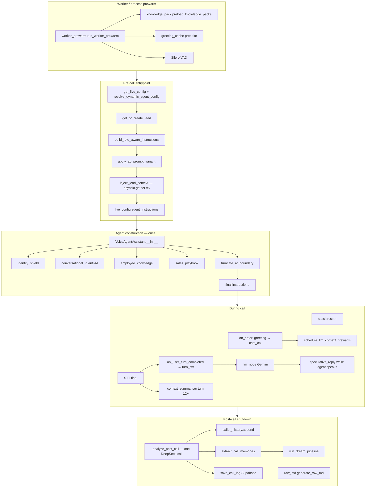

# VK Realty HME — Context Engineering Reference

Complete map of how conversational context is assembled, injected, compressed, persisted, and reloaded in `vk-realty-hme`. The live voice path is orchestrated by `agent.py`; durable lead memory lives in `re_voice_memory/` (not legacy `voice_memory/`).

---

## Table of contents

1. [Mental model](#1-mental-model)
2. [End-to-end lifecycle](#2-end-to-end-lifecycle)
3. [Static system prompt assembly](#3-static-system-prompt-assembly)
4. [Pre-call memory injection](#4-pre-call-memory-injection)
5. [LLM context prewarm](#5-llm-context-prewarm)
6. [Per-turn ephemeral injections](#6-per-turn-ephemeral-injections)
7. [Mid-call chat context compression](#7-mid-call-chat-context-compression)
8. [Speculative next-turn prep](#8-speculative-next-turn-prep)
9. [In-call signal buffer → post-call](#9-in-call-signal-buffer--post-call)
10. [Post-call pipeline](#10-post-call-pipeline)
11. [Token budgets and truncation](#11-token-budgets-and-truncation)
12. [Parallel vs sequential I/O](#12-parallel-vs-sequential-io)
13. [Persistence and next-call reload](#13-persistence-and-next-call-reload)
14. [Configuration flags](#14-configuration-flags)
15. [Module index](#15-module-index)
16. [Known gaps and implementation notes](#16-known-gaps-and-implementation-notes)

---

## 1. Mental model

Context in this codebase is **not one blob**. It is four layers with different lifetimes:

| Layer | Where it lives | Lifetime | LLM sees it |
|-------|----------------|----------|-------------|
| **Static system prompt** | `Agent.instructions` | Whole call | Every turn (system) |
| **Pre-call memory block** | Appended to `live_config["agent_instructions"]` before agent init | Whole call | Baked into static prompt |
| **Conversation history** | `agent.chat_ctx` / `agent._chat_ctx` | Grows per turn; summarised mid-call | User/assistant turns + persistent system summaries |
| **Per-turn injections** | `turn_ctx.add_message(role="system", …)` in `on_user_turn_completed` | Current LLM request only | Extra system messages for one reply |

**Design goal:** sub-600ms call startup for returning leads; zero added latency on the first real user turn via prewarm + parallel pre-call I/O.

---

## 2. End-to-end lifecycle



### Phase summary

| Phase | When | Primary files |
|-------|------|---------------|
| Worker prewarm | First LiveKit job on worker process | `worker_prewarm.py`, `knowledge_pack.py`, `greeting_cache.py` |
| Pre-call | Before `VoiceAgentAssistant` is created | `agent.py`, `re_voice_memory/inject.py`, `re_voice_memory/lead.py` |
| Agent init | Once per call | `agent.py` (`VoiceAgentAssistant.__init__`) |
| Call start | `session.start` → `on_enter` | `agent.py`, `llm_prewarm.py` |
| Per turn | Each STT-final user utterance | `agent.py` `on_user_turn_completed` |
| Background | Non-blocking parallel tasks | `speculative_reply.py`, `context_summariser.py` |
| Post-call | Shutdown hook | `agent.py`, `re_voice_memory/extract.py`, `caller_history.py` |

---

## 3. Static system prompt assembly

Built once in `VoiceAgentAssistant.__init__` (`agent.py`). Order is fixed — **identity and anti-AI patterns come before business instructions**.

### Assembly order

1. **Identity anchor** — `identity_shield.build_identity_anchor(backstory, preset)`
2. **Identity trap handler** — `build_identity_trap_handler_instruction()`
3. **Anti-AI response patterns** — `conversational_iq.build_anti_ai_response_patterns()`
4. **Base business instructions** — `live_config["agent_instructions"]` (already enriched by pre-call inject)
5. **Conversational mastery** — `get_conversational_mastery(lang_preset)` (preset strings in `agent.py`)
6. **Employee knowledge** — `employee_knowledge.build_employee_knowledge_instruction()`
7. **Sales playbook** — `sales_playbook.build_sales_playbook_instruction()`
8. **IST time context** — `get_ist_time_context()`
9. **Language directive** — `get_language_instruction(lang_preset)`
10. **Language overlay** — from `language_router.get_language_overlay(detected_lang)`
11. **TTS safety** — Sarvam script notes when applicable
12. **Tool call safety** — generic tool-use guardrails
13. **Interrupt instruction** — `interrupt_handler.get_interrupt_instruction()`

### Token budget enforcement

After concatenation:

- Count tokens via `count_tokens()` (tiktoken `gpt-4o` or word heuristic)
- Compare to `system_prompt_token_budget` (default **1000**)
- If over budget: `truncate_at_boundary()` — drops tail at sentence boundaries

```278:304:vk-realty-hme/agent.py
def count_tokens(text: str) -> int:
    ...

def truncate_at_boundary(text: str, max_tokens: int) -> str:
    ...
```

### What feeds `agent_instructions` before init

1. Raw `config.json` / DB agent `agent_instructions`
2. `build_role_aware_instructions()` — buyer/investor/seller/renter tone + language overlay
3. `apply_ab_prompt_variant()` — campaign A/B prompt
4. `inject_lead_context()` — lead/property/caller history blocks (see §4)

---

## 4. Pre-call memory injection

**File:** `re_voice_memory/inject.py`  
**Entry:** `inject_lead_context(phone, base_instructions, campaign_id, max_re_tokens, lang_preset, intent_score, caller_name)`

### Fast path (new lead)

Returns `base_instructions` unchanged when:

- `phone` is `unknown` / empty, **and**
- No lead profile, **and**
- No KV profile, **and**
- No caller history

Target: **0ms** extra I/O for brand-new numbers.

### Parallel I/O (returning lead)

Five tasks via `asyncio.gather`:

| Task | Source | I/O |
|------|--------|-----|
| `_task_profile` | `re_voice_memory/lead.load_lead_profile` | Disk (thread) |
| `_task_graph` | `re_voice_memory/property_graph.load_property_graph` | Disk (thread) |
| `_task_kv` | `re_voice_memory/kv_store.get_lead_hot_context` | Redis or SQLite |
| `_task_campaign` | `kv_get(f"campaign:{id}:listings")` | Redis/SQLite |
| `_task_caller_history` | `caller_history.load_caller_history` | Disk (thread) |

Target: **< 60ms** for returning leads.

### Context blocks (priority-sorted, budgeted)

Blocks are assembled into three slots with separate token budgets (`re_voice_memory/constants.py`):

| Slot | Budget constant | Default tokens | Contents |
|------|-----------------|----------------|----------|
| Company | `TOKEN_BUDGET_COMPANY_SLOT` | 200 | Hot facts from `knowledge_pack` (returning leads only) |
| Property | `TOKEN_BUDGET_PROPERTY_SLOT` | 120 | Property graph summary, campaign listings |
| Lead | `TOKEN_BUDGET_RE_SLOT` | 300 (agent passes `max_re_tokens=300`) | Identity, hot-lead instruction, live sales, objections, **caller history** |

Assembly uses `_assemble_budgeted(blocks, max_tokens)` — lower priority number = higher importance; blocks skipped if budget exceeded. Token estimate: `len(text) // 4`.

### Injected sections format

```
[COMPANY CONTEXT — verified facts]
...

[PROPERTY CONTEXT — listings & history]
...

[LEAD CONTEXT — from prior interactions]
...

Use this context to personalise the call. Do not tell the lead you are reading records.
```

### Role-aware base instructions

`build_role_aware_instructions()` appends tone overlays:

- **Buyer** — warm, aspirational, lifestyle
- **Investor** — ROI, yield, comparables
- **Seller** — empathetic, pricing reality
- **Renter** — practical, availability, deposit

Plus language overlay (Hinglish/Marathi vs Telugish vs English).

### Hot lead path

If `intent_score >= HOT_INTENT_SCORE_THRESHOLD` (7.0):

- Injects proactive-close instruction: skip generic discovery, propose concrete site visit

### Caller history block

**File:** `re_voice_memory/caller_history.py`

Post-call saves per phone (`leads/{phone}/caller_history.json`):

- `caller_name`, `phone`, `summary`, `call_at` (IST ISO)

Next call injects up to **3** most recent entries:

```
[PRIOR CALL HISTORY — same phone number]
Caller name: …
Phone (lookup key): +91…
• 02 Jul 2026, 11:35 AM IST — …summary…
```

Priority **0** in lead blocks (same tier as hot-lead instruction).

### Entrypoint wiring (`agent.py`)

```python
memory_task = safe_create_task(inject_lead_context(...))  # parallel with LLM/STT/TTS build
...
enriched = await memory_task
live_config["agent_instructions"] = enriched
agent = VoiceAgentAssistant(...)  # prewarm will see enriched instructions
```

---

## 5. LLM context prewarm

**File:** `llm_prewarm.py`  
**Trigger:** `on_enter` when greeting starts (`schedule_llm_context_prewarm`)

### Purpose

Stream a minimal completion through the **same** Gemini instance, system prompt, tool schemas, and greeting context the first real user turn will use. Warms connection + KV cache while caller hears the welcome line.

### Mechanism

1. Copy `agent.chat_ctx`
2. Ensure greeting is present as assistant message
3. Add synthetic user message `"."`
4. Stream with `max_completion_tokens=16`
5. Store task on `live_config["_llm_prewarm_task"]`
6. `await_llm_context_prewarm()` after `session.start` (best-effort, 12s timeout)

### Config

- `llm_context_prewarm` — default `true` in `config.json`
- Disabled → skip entirely, no latency cost

### Critical dependency

Prewarm only includes context that is already in `Agent.instructions` and `chat_ctx` **before** greeting. That is why:

- Pre-call inject must finish **before** `VoiceAgentAssistant` construction
- Caller history must be in `agent_instructions`, not added later

---

## 6. Per-turn ephemeral injections

**Hook:** `VoiceAgentAssistant.on_user_turn_completed(turn_ctx, new_message)` (`agent.py`)

LiveKit passes `turn_ctx` — system messages here affect **only the current reply**, not necessarily long-lived history (unless also committed via `speak_gated` / default LLM path).

### Execution order (sequential per turn)

| Step | Module | What gets injected |
|------|--------|-------------------|
| 1 | `speculative_reply` | `[NEXT-TURN PREP — trial]` hint if `for_turn` matches |
| 2 | `language_router` | Updates `live_config` detected language (not always a message) |
| 3 | `identity_shield` | **Trap path:** scripted deflection + `StopResponse` — **LLM skipped** |
| 4 | `knowledge_pack` | FAQ, inventory lines, market/competitor snippets |
| 5 | `conversational_iq.TopicMemory` | No-repeat topics instruction |
| 6 | `ProactiveInsightEngine` | `[PROACTIVE FOLLOW-UP]` after high-confidence FAQ/topics |
| 7 | `call_planner.CallPlanner` | Agenda instruction for current call phase |
| 8 | `sales_playbook.DealStageTracker` | Stage strategy when stage changes or at INTENT/PURCHASE/BOOKED |
| 9 | `sales_playbook.detect_objection` | `[OBJECTION RESPONSE HINT]` + buffer to `AgentTools` |
| 10 | `re_voice_memory.objection_log` | `[OBJECTION MEMORY]` failed scripts to avoid |
| 11 | `emotion_detector` | Temporary emotion annotation (~2s TTL) |
| 12 | Turn limit | Final-turn goodbye instruction if `turn_count >= max_turns` |

### Knowledge pack (per-turn RAG-lite)

**File:** `knowledge_pack.py`

- **Hot path:** in-memory JSON indexes (`data/company_knowledge/`, `data/*_inventory.json`, `data/employee_backstory.json`)
- **Latency budget:** <3ms after first load (`preload_knowledge_packs()` at worker prewarm + session start)
- **Optional:** Qdrant vector FAQ fallback if `QDRANT_URL` set (`resolve_turn_async`)
- **Confidence:** FAQ injected when `confidence >= 0.70`; lookup min 0.45
- **Format cap:** ~250 tokens in `format_turn_injection()`

Intent routing via `employee_intent_router` for pack selection.

### Identity trap (special case)

If `handle_identity_trap_turn()` returns a deflection:

- Agent speaks scripted line via `speak_gated(add_to_chat_ctx=True)`
- Raises `StopResponse` — **no LLM call** for that turn
- Context for that turn is the deflection only

### LLM reply path

After hooks, LiveKit calls `llm_node` → Gemini stream with:

- Static `instructions`
- Full `chat_ctx` history (including summaries)
- `turn_ctx` ephemeral system messages
- Function tools from `AgentTools`
- Dynamic temperature from deal stage in `llm_node`

TTS passes through `identity_shield.identity_safe_gate` before audio.

---

## 7. Mid-call chat context compression

**File:** `context_summariser.py`  
**Model:** DeepSeek via `secondary_llm` (not live Gemini)

### Schedule

| Constant | Value |
|----------|-------|
| `SUMMARISATION_TRIGGER_TURN` | 12 |
| Repeat interval | Every **10** turns (12, 22, 32, …) |
| `TURNS_TO_SUMMARISE` | First 10 user/assistant messages in window |
| `MAX_SUMMARY_TOKENS` | 150 target in prompt |
| LLM `max_tokens` | 200 |

### Effect on `chat_ctx`

1. Takes first 10 conversational messages
2. DeepSeek produces `[SUMMARY: budget=X, areas=Y, …]` format
3. **Removes** those 10 messages from `agent._chat_ctx`
4. Inserts summary as `role=system` near index 1
5. Adds call-state note that greeting already happened

### Trigger site

After STT final in `agent.py` (~3811) — `safe_create_task(maybe_summarise_context(...))` — **non-blocking**.

---

## 8. Speculative next-turn prep

**File:** `speculative_reply.py`

### Purpose

While the agent is speaking (user listening), fire a **separate** low-token Gemini call to draft a hint for the **next** user turn. Reduces perceived latency if the hint is relevant.

### Gating

| Flag | Default |
|------|---------|
| `speculative_reply_enabled` | `true` |
| `speculative_reply_min_speech_ms` | `2000` |

Also requires estimated agent speech duration ≥ min (chars × 42ms/char).

### Flow

1. `agent_speech_started` → `schedule_speculative_prep`
2. After 600ms delay, Gemini reads recent `chat_ctx` + last assistant line
3. Stores hint on `live_config["_speculative_reply_hint"]` with `for_turn = turn_count + 1`
4. `on_user_turn_completed` → `consume_speculative_hint(turn=tc)` injects if turn matches
5. Journal stored in `extracted_info.speculative_thinking` on call log

### Limits

- Hint capped at **480 chars**
- Gemini `max_output_tokens=120`
- Tagged `[NEXT-TURN PREP — trial]` — model instructed to use only if relevant
- **Never blocks** live reply path

---

## 9. In-call signal buffer → post-call

**Class:** `AgentTools` in `agent.py`

During the call, tools and turn hooks buffer structured signals:

| Key | Example use |
|-----|-------------|
| `listing_discussed` | Property graph update |
| `viewing_scheduled` | Site visit / CRM |
| `objection` | Objection log |
| `offer_intent` | Offer tracking |

`drain_context_buffer()` at shutdown feeds:

- `raw_md.generate_raw_md()` metadata
- `extract_call_memories(buffered_context=...)`

---

## 10. Post-call pipeline

Shutdown sequence in `agent.py` (order matters for phone resolution + summary).

### Unified analysis (one DeepSeek call)

**File:** `re_voice_memory/extract.py`

```python
@dataclass
class PostCallAnalysis:
    sentiment: str
    summary: dict          # dashboard fields
    scores: IntentScores   # intent scoring
    facts: dict            # lead fact extraction
```

`analyze_post_call(transcript)` — single JSON pass replaces multiple legacy DeepSeek calls.

Outputs:

- `sentiment` for call log
- `call_summary` / `call_purpose` via `deepseek_summariser.format_summary_for_db()`
- `precomputed_analysis` passed to `extract_call_memories` (skips duplicate LLM)

### Caller history save

**File:** `re_voice_memory/caller_history.py`

```python
append_call_history(phone, caller_name=..., summary=call_summary, call_at=call_dt.isoformat())
```

Background `asyncio.to_thread` — does not block shutdown.

### Durable memory extract

**File:** `re_voice_memory/extract.py` — `extract_call_memories()`

Updates (per-phone locked):

- `lead_profile.md` — budget, areas, name, stage, call_count, intent_score
- `objection_log.md` — new objections
- `property_interests.md` — graph signals
- `call_summaries/summary_*.md` — per-call summary files
- CRM sync via `crm_sync` (inside extract task)
- Intent scoring via `intent_score.py`

### Dream pipeline

**File:** `re_voice_memory/dream.py` — `run_dream_pipeline(phone)` (background)

Consolidates 3+ call summaries into `consolidated_profile.md`, prunes property graph. **Not directly injected on next call today** — consolidation artifact.

### Artifacts

| Output | Path |
|--------|------|
| Raw transcript MD | `calls/{room_name}/raw.md` |
| Call log row | Supabase `call_logs` |
| Speculative journal | `extracted_info.speculative_thinking` |
| Quality / audit | `extracted_info.quality_scores`, `call_audit` |

---

## 11. Token budgets and truncation

### System prompt (static)

| Setting | Default | Source |
|---------|---------|--------|
| `system_prompt_token_budget` | 1000 | `config.json` |
| `SYSTEM_PROMPT_TOKEN_BUDGET` env | 1000 | `agent.py` override |
| Truncation | Sentence-boundary tail drop | `truncate_at_boundary()` |

### Pre-call inject slots

| Constant | Tokens |
|----------|--------|
| `TOKEN_BUDGET_RE_SLOT` | 300 |
| `TOKEN_BUDGET_COMPANY_SLOT` | 200 |
| `TOKEN_BUDGET_PROPERTY_SLOT` | 120 |
| `TOKEN_BUDGET_SYSTEM` | 900 (defined, inject uses slot model) |
| `MAX_INJECTED_MEMORIES` | 5 (defined) |

Sub-budgets inside inject:

- Property graph prompt: 80 tokens
- Objection history prompt: 60 tokens
- Caller history summary: 400 chars stored, 3 entries injected

### Per-turn / background

| Component | Cap |
|-----------|-----|
| `knowledge_pack` injection | ~250 tokens |
| `speculative_reply` hint | 480 chars |
| `context_summariser` | 150 token target |
| `llm_prewarm` completion | 16 tokens |
| `analyze_post_call` transcript | 100k chars max; LLM 1600 tokens |
| Live reply | `llm_max_completion_tokens` default **200** (clamped 60–300) |

### Counting method

`count_tokens()` prefers tiktoken `gpt-4o`; falls back to `words * 4/3`. Inject uses `len(text)//4`.

---

## 12. Parallel vs sequential I/O

### Parallel

| Operation | Mechanism |
|-----------|-----------|
| Pre-call inject | `asyncio.gather` × 5 tasks |
| Inject vs provider setup | `memory_task` concurrent with LLM/STT/TTS build |
| KV hot context (SQLite mode) | `asyncio.gather` per key |
| Post-call extract + dream | `safe_create_task` — fire-and-forget |
| Caller history save | `asyncio.to_thread` background |
| Speculative prep | Separate task while agent speaks |
| Context summarisation | `safe_create_task` after STT final |

### Sequential (latency-critical path)

| Operation | Why |
|-----------|-----|
| `await memory_task` before agent init | Prewarm must see full instructions |
| `on_user_turn_completed` injectors | Fixed priority order on `turn_ctx` |
| `knowledge_pack.resolve_turn_async` | On turn path (JSON path <3ms; Qdrant may add latency) |
| Per-phone extract lock | `asyncio.Lock` in `extract_call_memories` |

---

## 13. Persistence and next-call reload

### Storage root

```
MEMORY_DIR = $RE_MEMORY_DIR or ~/.hermes/re-voice-memory
```

### Per-phone files

| Path | Written by | Read by (next call) |
|------|------------|---------------------|
| `leads/{phone}/lead_profile.md` | `save_lead_profile` / extract | `load_lead_profile` → inject |
| `leads/{phone}/caller_history.json` | `append_call_history` | `load_caller_history` → inject |
| `leads/{phone}/property_interests.md` | property graph save | `load_property_graph` → inject |
| `leads/{phone}/objection_log.md` | `append_objection` | inject + `get_failed_scripts` per turn |
| `leads/{phone}/call_summaries/summary_*.md` | extract | dream consolidation |
| `leads/{phone}/consolidated_profile.md` | dream pipeline | not injected directly today |

### Call-level

| Path | Purpose |
|------|---------|
| `calls/{room}/raw.md` | Canonical transcript + metadata |
| `.extraction_pending/{room}.json` | Crash recovery marker |
| `.kv_store.db` or Redis `re_voice:*` | Hot lead fields, campaign listings |

### Next-call injection checklist (returning lead)

1. Lead profile — name, role, budget, areas, stage, call count  
2. Caller history — up to 3 prior summaries with dates  
3. Property graph — listings discussed, signals  
4. Objection log — history + failed scripts  
5. KV hot context — if populated (`profile`, `intent_score`, `deal_stage`, …)  
6. Campaign listings — `campaign:{id}:listings`  
7. Company hot facts — `knowledge_pack.hot_facts_block` (returning only)  
8. Live sales context — `dashboard_analytics.build_live_sales_context`  
9. Hot-lead instruction — if `intent_score ≥ 7`  

### Post-call → next-call loop

```
shutdown:
  analyze_post_call(transcript)     → sentiment, summary, facts, scores
  append_call_history(summary)    → caller_history.json
  extract_call_memories(...)        → lead_profile, objections, graph, CRM
  run_dream_pipeline(phone)         → consolidation (async)

next inbound call:
  inject_lead_context(phone)        → parallel load all of the above
  build VoiceAgentAssistant         → static prompt includes inject block
  on_enter → llm_prewarm            → first user turn already warm
```

---

## 14. Configuration flags

### `config.json` (context-relevant)

| Key | Default | Effect |
|-----|---------|--------|
| `agent_instructions` | Arjun VK Realty persona | Core business prompt |
| `lang_preset` | `"hme"` | Hinglish/Marathi packs vs tinglish |
| `languages` | `["hi","en-in","mr"]` | STT/language routing |
| `system_prompt_token_budget` | `1000` | Static prompt truncation |
| `llm_context_prewarm` | `true` | Greeting-time LLM warm |
| `speculative_reply_enabled` | `true` | Background next-turn prep |
| `speculative_reply_min_speech_ms` | `2000` | Min agent speech before prep |
| `llm_max_completion_tokens` | `200` | Reply length cap |
| `llm_temperature` | `0.7` | Base temp (+ dynamic in `llm_node`) |
| `max_turns` | `40` | Final-turn wrap-up injection |
| `welcome_dynamic` | `true` | `[user_name]` in greeting |
| `welcome_interruptable` | `true` | Greeting interrupt policy |
| `filler_phrases_enabled` | `false` | TTFT filler during LLM stream |
| `backchannel_enabled` | `false` | Backchannel controller |
| `silence_guard_enabled` | `false` | Silence bridge phrases |
| `campaign_id` | `""` | A/B prompt + campaign listings KV |
| `gemini_model` | `gemini-2.5-flash-lite` | Live conversation LLM |

### Environment variables

| Env | Effect |
|-----|--------|
| `SYSTEM_PROMPT_TOKEN_BUDGET` | Override default 1000 |
| `RE_MEMORY_DIR` | Memory root path |
| `REDIS_URL` | KV fast path for inject |
| `QDRANT_URL` | Vector FAQ fallback in knowledge_pack |
| `DEEPSEEK_API_KEY` | Post-call analysis + context summariser |
| `GEMINI_API_KEY` / `GOOGLE_API_KEY` | Live LLM + speculative prep |

### `live_config` internal keys (runtime)

| Key | Set by | Purpose |
|-----|--------|---------|
| `_deal_tracker` | session start | Deal stage per turn |
| `_call_planner` | session start | Call agenda |
| `_topic_memory` | session start | Topic dedup |
| `_speculative_reply_hint` | speculative_reply | Next-turn trial hint |
| `_speculative_reply_journal` | speculative_reply | Debug/inspect thinking |
| `_llm_prewarm_task` | llm_prewarm | Await prewarm |
| `_caller_name` | entrypoint | Greeting personalization |
| `detected_language` | language_router | Per-turn overlay |
| `prompt_version`, `is_canary` | canary loader | A/B engine tracking |

---

## 15. Module index

| Module | Path | Role in context engineering |
|--------|------|----------------------------|
| Orchestrator | `agent.py` | Lifecycle, prompt build, hooks, shutdown |
| Memory inject | `re_voice_memory/inject.py` | Pre-call parallel assembly |
| Lead CRUD | `re_voice_memory/lead.py` | `LeadProfile` disk format |
| KV store | `re_voice_memory/kv_store.py` | Hot lead Redis/SQLite |
| Property graph | `re_voice_memory/property_graph.py` | Listing interest signals |
| Caller history | `re_voice_memory/caller_history.py` | Cross-call summaries |
| Objection log | `re_voice_memory/objection_log.py` | Objections + failed scripts |
| Post-call extract | `re_voice_memory/extract.py` | Unified analysis + profile update |
| Raw MD | `re_voice_memory/raw_md.py` | Transcript artifact |
| Dream | `re_voice_memory/dream.py` | Long-horizon consolidation |
| Constants | `re_voice_memory/constants.py` | Budgets, TTLs, thresholds |
| LLM prewarm | `llm_prewarm.py` | Greeting-time warm |
| Speculative reply | `speculative_reply.py` | Next-turn background prep |
| Context summariser | `context_summariser.py` | Mid-call window compression |
| Knowledge pack | `knowledge_pack.py` | Per-turn FAQ/inventory/market |
| Identity shield | `identity_shield.py` | Anchor, traps, TTS gate |
| Employee knowledge | `employee_knowledge.py` | Static company block in system prompt |
| Employee intent | `employee_intent_router.py` | Routes knowledge lookups |
| Sales playbook | `sales_playbook.py` | Deal stage, objections, methodology |
| Call planner | `call_planner.py` | Qualify → discover → pitch → close |
| Conversational IQ | `conversational_iq.py` | Topics, proactive follow-ups, disfluency |
| Language router | `language_router.py` | Presets, overlays, per-turn language |
| Emotion detector | `emotion_detector.py` | Keyword emotion annotations |
| Secondary LLM | `secondary_llm.py` | DeepSeek client |
| DeepSeek summariser | `deepseek_summariser.py` | Wrapper over `analyze_post_call` |
| Dashboard analytics | `dashboard_analytics.py` | `build_live_sales_context` |
| Worker prewarm | `worker_prewarm.py` | Process-level preload |
| Greeting cache | `greeting_cache.py` | Prebaked greeting PCM |
| Config | `config.json`, `config_store.py` | Runtime flags |
| Data packs | `data/company_knowledge/*.json`, `data/*_inventory.json` | Knowledge sources |

**Legacy:** `voice_memory/` exists for migration; **not** on the live `agent.py` path.

---

## 16. Known gaps and implementation notes

1. **`set_lead_hot_context`** is implemented in `kv_store.py` but not called from `extract_call_memories` / `save_lead_profile` — KV inject path depends on external population (e.g. CRM).

2. **`build_conversational_mastery_prompt`** is imported in `agent.py` but unused; static `get_conversational_mastery()` preset strings are used instead (no per-turn emotion/deal-stage mastery variant).

3. **`ResponseLengthPolicy`** in `conversational_iq.py` is defined but not wired to `turn_ctx`.

4. **Two memory systems:** live path is `re_voice_memory/`; `voice_memory/` is legacy.

5. **Identity trap** bypasses LLM — that turn's "context" is only the scripted deflection.

6. **Speculative hints** are trial-only; consumed only when `for_turn` matches current turn; irrelevant hints should be ignored by prompt framing.

7. **Truncation** applies to the **entire** static system prompt tail — if over budget, identity + business + playbook may be cut from the end; monitor `[PROMPT]` logs.

8. **Consolidated profile** from dream pipeline is not yet injected on next call — only per-call summaries, profile, graph, objections, and caller history are.

9. **Gemini** handles live conversation; **DeepSeek** handles post-call analysis, context summarisation, and dashboard regenerate — intentional model split for cost/latency.

---

## Quick reference: `chat_ctx` lifecycle

```
[STATIC] Agent.instructions
         (identity + anti-AI + enriched agent_instructions + playbook + …)
              ↓
[chat_ctx] assistant: greeting (on_enter, add_to_chat_ctx=True)
              ↓
[background] llm_prewarm copies chat_ctx + greeting + user "." (not committed)
              ↓
Per turn:
  user message (STT final)
  on_user_turn_completed → turn_ctx += ephemeral system injections
  llm_node → Gemini(chat_ctx + turn_ctx + tools)
  assistant stream → tts_node → identity_safe_gate
              ↓
Turn 12, 22, 32, …:
  context_summariser replaces old user/assistant msgs with [SUMMARY] system block
              ↓
Shutdown:
  transcript → analyze_post_call → caller_history → extract → dream
  next call: inject_lead_context reads persisted state in parallel
```

---

*Generated for `vk-realty-hme` — reflects codebase as of July 2026. Primary entrypoint: `agent.py`; memory root: `~/.hermes/re-voice-memory`.*